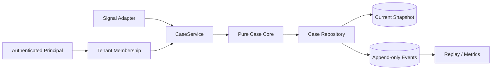

# Mimamori Care Ops

**見守りのラストワンマイルを、支援完了まで。**

[](https://github.com/Takzin1/mimamori-care-ops/actions/workflows/ci.yml)

Mimamori Care Ops is a **Care Operations Engine** for turning a signal that requires human attention into a **verifiably completed support case**.

> Detection is upstream. Notification is upstream.
> The product boundary starts where accountable human action begins.

## Status

**Architecture / core prototype — not production-ready.**

What is already implemented and tested:

- strict Case state machine
- append-only operational events + replay
- accountable assignment and handoff
- evidence-backed completion
- optimistic concurrency / stale-write rejection
- tenant-scoped persistence contract
- production identity boundary + persistent tenant membership
- audited membership provisioning / revocation control plane
- authenticated Care Ops HTTP boundary for Queue / Case / metrics / commands
- server-only Supabase runtime composition with explicit credential routing
- browser-safe Care Ops API client with per-request token provider
- ephemeral browser session coordinator with explicit 401/reauth handling
- Supabase browser Auth reference bridge with no Care Ops token persistence
- renderer-neutral live Console workspace with race/conflict handling
- server-projected operator / Case capabilities from shared Core + RBAC rules
- dependency-free live Console DOM renderer driven by server capabilities
- operational health/readiness + non-PII structured log/metrics boundary
- tenant staff membership + role-based command authorization
- retry-safe Signal idempotency + immutable Case lineage
- explicit Case priority + deterministic SLA/aging evaluation
- authorized, explainable Case Queue projection
- production-facing Supabase/PostgREST CaseRepository adapter
- transactional outbox with worker lease/retry/dead-letter semantics
- payload-free outbox health monitoring for operations
- safe synthetic staging preflight for liveness/readiness, exact Origin/CORS, and unauthenticated fail-closed checks
- real PostgreSQL 17 integration CI
- Postgres/Supabase Case Store contract with RLS and fail-closed RPC access
- bounded Supabase/PostgREST outbound request deadlines
- fail-closed pre-handler request-admission boundary
- immutable CI action/image refs and integrity-pinned TypeScript toolchain
- Time to Completion and supporting operational metrics

Not yet production-ready:

- intentionally provisioned production Auth environment and login/session UX
- production admin credential provisioning / execution path for the membership control plane
- production Auth-provider/login UX and live Console deployment
- intentionally provisioned staging/production observability providers, alert ownership, and completed operational drills
- production shared/edge request-admission provider and thresholds
- final repository branch-protection / reviewer deployment settings

See [Project Status](docs/project-status.md) and the open GitHub Issues for the active roadmap.

## The problem boundary

Many monitoring products stop at detection or notification.

Mimamori Care Ops begins after a signal exists and a human still needs to answer:

1. Who owns this Case?
2. Has anyone acknowledged it?
3. What action started?
4. Did responsibility transfer safely?
5. Was support actually completed?
6. What evidence proves completion?
7. How long did completion take?

The system is designed around this operational chain:

```text
Signal
  -> Case
  -> Acknowledge
  -> Assign
  -> Action
  -> Handoff
  -> Completion
  -> Close
```

## Architecture



The Core intentionally does **not** know about LINE, Supabase, UI frameworks, municipalities, sensors, or AI providers.

### Core invariants

- **No ownership gap during handoff**
  The outgoing responder remains accountable until the target explicitly accepts.

- **No status-only completion**
  Completion requires an outcome, summary, accountable actor, timestamp, and evidence.

- **No stale overwrite**
  Commands carry `expectedVersion`; stale writes fail instead of winning silently.

- **No cross-tenant addressing by Case ID alone**
  Persistence is scoped by `tenantId + caseId`.

- **No caller-controlled audit actor**
  Application commands bind `principalId -> trusted membership -> actorId`.

- **No duplicate Case from Signal retry**
  `tenantId + sourceAdapter + sourceSignalId` is the idempotency boundary.

- **No hidden SLA clock reset**
  Priority changes are explicit events and do not reset elapsed operational time.

- **Replayable operations**
  Current Case state can be reconstructed from the event stream.

Read the full [Architecture](docs/architecture.md).

## North-star KPI

**Time to Completion (TTC)**

Supporting metrics:

- Time to Acknowledge
- Time to Assignment
- Time to First Action
- Handoff Count
- Reopen Rate
- Unassigned Aging
- SLA Breach

The optimization target is not notification volume or AI usage. It is **verifiable support completion**.

## Repository map

```text
src/
  core/          pure Case state machine and metrics
  access/        tenant staff membership and authorization
  application/   operational orchestration
  http/          authenticated Web Request/Response transport
  runtime/        server-only application/operational runtime composition
  deployment/     validated staging/production environment + composition root
  client/         browser-safe HTTP API client
  session/        ephemeral browser session coordination
  console/        live Console workspace state
  console-web/    dependency-free live Console DOM renderer
  persistence/   repository contracts and in-memory reference adapter

db/
  case_store.sql Postgres/Supabase persistence contract

tests/
  core, persistence, authorization, E2E and SQL invariants

docs/
  architecture, Case Queue contract, reviewer guide, demo scenario, ADRs and release readiness
```

## Responder Console reviewer demo

A browser-only synthetic demo is included at:

```
demo/responder-console/index.html
```

It demonstrates the GK workflow without production credentials or real resident data:

```
NEW
→ ACKNOWLEDGED
→ ASSIGNED
→ IN_PROGRESS
→ HANDOFF_PENDING
→ IN_PROGRESS
→ COMPLETED + evidence
→ CLOSED
```

The demo is intentionally disconnected from production data until production identity integration is implemented.

Deployment guide: [Reviewer Demo Deployment](docs/reviewer-demo-deployment.md). A dedicated Vercel project is required; do not reuse legacy Mimamori projects.

## External review

Start with the [External Review Package](docs/external-review.md) for the current capability/evidence boundary, known gaps, CI evidence, and security review path.

Repository workflow and branch-protection recommendations are documented in [Repository Governance](docs/repository-governance.md). Release semantics are documented in [Release Policy](docs/release-policy.md).

Operational references:
- [Membership Administration Runbook](docs/membership-admin-runbook.md)
- [Production Auth Provider Wiring](docs/production-auth-provider.md)
- [Operations and Observability Baseline](docs/operations-observability.md)
- [Incident Response](docs/incident-response.md)
- [Backup, Restore, and Rollback](docs/backup-restore-rollback.md)
- [Outbox and Dead-Letter Operations](docs/outbox-operations.md)
- [Deployment Environment Contract](docs/deployment-environment.md)
- [Staging Evidence Template](docs/staging-evidence-template.md)
- [Production Evidence Index](docs/production-evidence-index.md)

## Review this repository in 10 minutes

Start here:

1. [Reviewer Guide](docs/reviewer-guide.md)
2. [Architecture](docs/architecture.md)
3. [ADR 0001 — Last-mile product boundary](docs/adr/0001-last-mile-product-boundary.md)
4. [ADR 0002 — Tenant-scoped persistence](docs/adr/0002-tenant-scoped-persistence.md)
5. [ADR 0003 — Tenant staff authorization](docs/adr/0003-tenant-staff-command-authorization.md)
6. [ADR 0004 — Signal idempotency](docs/adr/0004-signal-idempotency.md)
7. [ADR 0005 — Priority and SLA aging](docs/adr/0005-priority-sla-aging.md)
8. [ADR 0006 — Transactional outbox](docs/adr/0006-transactional-outbox.md)
9. [ADR 0007 — Production identity boundary](docs/adr/0007-production-identity-boundary.md)
10. [ADR 0008 — Audited membership control plane](docs/adr/0008-audited-membership-control-plane.md)
11. [ADR 0009 — Authenticated HTTP boundary](docs/adr/0009-authenticated-http-boundary.md)
12. [HTTP API](docs/http-api.md)
13. [ADR 0010 — Server runtime composition](docs/adr/0010-server-runtime-composition.md)
14. [Server Runtime](docs/server-runtime.md)
15. [ADR 0011 — Browser client/session boundary](docs/adr/0011-browser-client-session-boundary.md)
16. [Browser Client](docs/browser-client.md)
17. [ADR 0012 — Ephemeral session coordinator](docs/adr/0012-ephemeral-session-coordinator.md)
18. [Browser Session](docs/browser-session.md)
19. [ADR 0013 — Live Console workspace](docs/adr/0013-live-console-workspace.md)
20. [Live Console Workspace](docs/live-console-workspace.md)
21. [ADR 0014 — Server-projected Console capabilities](docs/adr/0014-server-projected-console-capabilities.md)
22. [Console Capabilities](docs/console-capabilities.md)
23. [ADR 0015 — Dependency-free Console renderer](docs/adr/0015-dependency-free-console-renderer.md)
24. [Live Console Web Renderer](docs/live-console-web-renderer.md)
25. `tests/application-case-service.test.ts`
26. `tests/identity.test.ts`
27. `tests/http-api.test.ts`
28. `tests/sla.test.ts`
29. [Responder Console contract](docs/responder-console.md)
30. `demo/responder-console/index.html`
31. `db/case_store.sql`

## Development

Requirements:

- Node.js 24+

Run:

```bash
npm run typecheck
npm test
npm run test:coverage
```

Before deployment, copy `.env.example` to a local ignored environment file or configure the same variables in the provider, then validate the configuration without making network requests:

```bash
npm run config:validate
```

The config doctor emits only non-secret metadata and never prints credential values.

After a synthetic staging API and exact Console origin are provisioned, run the credential-free boundary preflight:

```bash
npm run preflight:staging -- \
  --base-url https://api.example.test \
  --console-origin https://console.example.test
```

The preflight sends no access token, resident data, Case payload, or completion evidence. It verifies liveness/readiness, unexpected-Origin rejection, the narrow CORS contract, and fail-closed unauthenticated browser behavior.

The repository keeps runtime dependencies at zero. TypeScript 5.9.2 is an exact devDependency installed from the committed integrity lockfile with frozen `npm ci` in CI.

## Security and data policy

This repository is designed around **synthetic development/test data only**.

Do not commit:

- real resident names or identifiers
- medical or care records
- phone numbers / LINE IDs
- production credentials
- access tokens
- service-role keys
- real completion evidence containing personal information

See [SECURITY.md](SECURITY.md) and [Security Model](docs/security-model.md).

## Product boundary

This repository is **not** intended to become:

- a generic monitoring app
- a municipal super-app
- a sensor platform
- a notification-volume optimization product
- an AI-first decision maker

AI may assist normalization, summarization, extraction, or triage suggestions. AI must not silently complete a Case, accept a handoff, replace accountable human ownership, or rewrite operational evidence.

## Lineage

Source PoC repository:

- `Takzin1/mimamori-kun`
- Frozen reference branch: `release/mimamori-poc-2026`
- Frozen reference commit: `73d8f95aa6b3e860b632e6d35a9413abbd9df4f2`

This repository does **not** copy the legacy application wholesale. Only validated operational primitives are reintroduced deliberately.

## Contributing

See [CONTRIBUTING.md](CONTRIBUTING.md). Architectural changes should be recorded as ADRs and must preserve the documented operational invariants.


## Personalized Care Operations (experimental branch)

**Synthetic-only prototype; not production-ready.** See [scope, local demo, API and security gates](docs/personalized-care.md). Existing monitoring and CareOps behavior are preserved. New migration is reference-only and not applied; production runtime is not connected. Actual Node/Postgres regression tests and browser verification remain pending.

Phase 2 synthetic persistence: `node scripts/personalized-care-demo.mjs --persist`. Local SQLite only; Case promotion disabled in this mode. Supervisor follow-up review API added. See the Phase 2 section of the experimental documentation.

Phase 3-A: opt-in LINE staff verification and parameterized PostgreSQL identity directory code added. Reference SQL and LIFF helper are not deployed; see experimental documentation.

Phase 3-B: experimental isolated PostgreSQL snapshot adapter and reference SQL with CAS + append-only audit journal. Synthetic staging only; no production activation.

Phase 4-A: approved SOP lexical search, exact source excerpts, version references and supervisor coverage view. No external AI. Synthetic preview only.

Phase 5-A (education-first): MIMAMORI Academy, version-pinned supervisor-approved lessons, independent review, per-actor spaced practice and evidence feedback. Synthetic only; no certification or personnel ranking.

Phase 5-B: opt-in synthetic conversation simulator, independently approved branching scenarios, actor-scoped resume and evidence-based debrief. Scripted, no external AI or certification.
