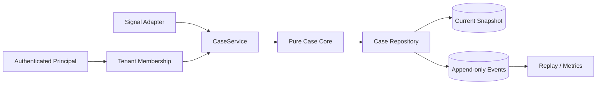

# Mimamori Care Ops

**見守りのラストワンマイルを、支援完了まで。**

[](https://github.com/Takzin1/mimamori-care-ops/actions/workflows/ci.yml)

Mimamori Care Ops is a **Care Operations Engine** for turning a signal that requires human attention into a **verifiably completed support case**.

> Detection is upstream. Notification is upstream.
> The product boundary starts where accountable human action begins.

## Status

**Architecture / core prototype — not production-ready.**

What is already implemented and tested:

- strict Case state machine
- append-only operational events + replay
- accountable assignment and handoff
- evidence-backed completion
- optimistic concurrency / stale-write rejection
- tenant-scoped persistence contract
- tenant staff membership + role-based command authorization
- retry-safe Signal idempotency + immutable Case lineage
- explicit Case priority + deterministic SLA/aging evaluation
- authorized, explainable Case Queue projection
- production-facing Supabase/PostgREST CaseRepository adapter
- real PostgreSQL 17 integration CI
- Postgres/Supabase Case Store contract with RLS and fail-closed RPC access
- Time to Completion and supporting operational metrics

Not yet production-ready:

- production authentication provider integration
- deployment / observability / incident runbook

See [Project Status](docs/project-status.md) and the open GitHub Issues for the active roadmap.

## The problem boundary

Many monitoring products stop at detection or notification.

Mimamori Care Ops begins after a signal exists and a human still needs to answer:

1. Who owns this Case?
2. Has anyone acknowledged it?
3. What action started?
4. Did responsibility transfer safely?
5. Was support actually completed?
6. What evidence proves completion?
7. How long did completion take?

The system is designed around this operational chain:

```text
Signal
  -> Case
  -> Acknowledge
  -> Assign
  -> Action
  -> Handoff
  -> Completion
  -> Close
```

## Architecture



The Core intentionally does **not** know about LINE, Supabase, UI frameworks, municipalities, sensors, or AI providers.

### Core invariants

- **No ownership gap during handoff**
  The outgoing responder remains accountable until the target explicitly accepts.

- **No status-only completion**
  Completion requires an outcome, summary, accountable actor, timestamp, and evidence.

- **No stale overwrite**
  Commands carry `expectedVersion`; stale writes fail instead of winning silently.

- **No cross-tenant addressing by Case ID alone**
  Persistence is scoped by `tenantId + caseId`.

- **No caller-controlled audit actor**
  Application commands bind `principalId -> trusted membership -> actorId`.

- **No duplicate Case from Signal retry**
  `tenantId + sourceAdapter + sourceSignalId` is the idempotency boundary.

- **No hidden SLA clock reset**
  Priority changes are explicit events and do not reset elapsed operational time.

- **Replayable operations**
  Current Case state can be reconstructed from the event stream.

Read the full [Architecture](docs/architecture.md).

## North-star KPI

**Time to Completion (TTC)**

Supporting metrics:

- Time to Acknowledge
- Time to Assignment
- Time to First Action
- Handoff Count
- Reopen Rate
- Unassigned Aging
- SLA Breach

The optimization target is not notification volume or AI usage. It is **verifiable support completion**.

## Repository map

```text
src/
  core/          pure Case state machine and metrics
  access/        tenant staff membership and authorization
  application/   operational orchestration
  persistence/   repository contracts and in-memory reference adapter

db/
  case_store.sql Postgres/Supabase persistence contract

tests/
  core, persistence, authorization, E2E and SQL invariants

docs/
  architecture, Case Queue contract, reviewer guide, demo scenario, ADRs and release readiness
```

## Review this repository in 10 minutes

Start here:

1. [Reviewer Guide](docs/reviewer-guide.md)
2. [Architecture](docs/architecture.md)
3. [ADR 0001 — Last-mile product boundary](docs/adr/0001-last-mile-product-boundary.md)
4. [ADR 0002 — Tenant-scoped persistence](docs/adr/0002-tenant-scoped-persistence.md)
5. [ADR 0003 — Tenant staff authorization](docs/adr/0003-tenant-staff-command-authorization.md)
6. [ADR 0004 — Signal idempotency](docs/adr/0004-signal-idempotency.md)
7. [ADR 0005 — Priority and SLA aging](docs/adr/0005-priority-sla-aging.md)
8. `tests/application-case-service.test.ts`
9. `tests/sla.test.ts`
10. `db/case_store.sql`

## Development

Requirements:

- Node.js 24+

Run:

```bash
npm run typecheck
npm test
npm run test:coverage
```

The repository currently keeps runtime dependencies at zero. TypeScript is pinned in the typecheck command until dependency installation is formalized.

## Security and data policy

This repository is designed around **synthetic development/test data only**.

Do not commit:

- real resident names or identifiers
- medical or care records
- phone numbers / LINE IDs
- production credentials
- access tokens
- service-role keys
- real completion evidence containing personal information

See [SECURITY.md](SECURITY.md) and [Security Model](docs/security-model.md).

## Product boundary

This repository is **not** intended to become:

- a generic monitoring app
- a municipal super-app
- a sensor platform
- a notification-volume optimization product
- an AI-first decision maker

AI may assist normalization, summarization, extraction, or triage suggestions. AI must not silently complete a Case, accept a handoff, replace accountable human ownership, or rewrite operational evidence.

## Lineage

Source PoC repository:

- `Takzin1/mimamori-kun`
- Frozen reference branch: `release/mimamori-poc-2026`
- Frozen reference commit: `73d8f95aa6b3e860b632e6d35a9413abbd9df4f2`

This repository does **not** copy the legacy application wholesale. Only validated operational primitives are reintroduced deliberately.

## Contributing

See [CONTRIBUTING.md](CONTRIBUTING.md). Architectural changes should be recorded as ADRs and must preserve the documented operational invariants.
